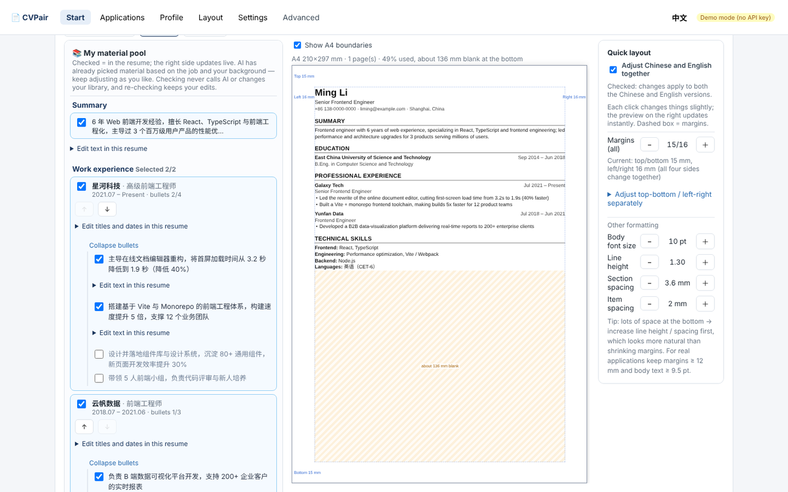
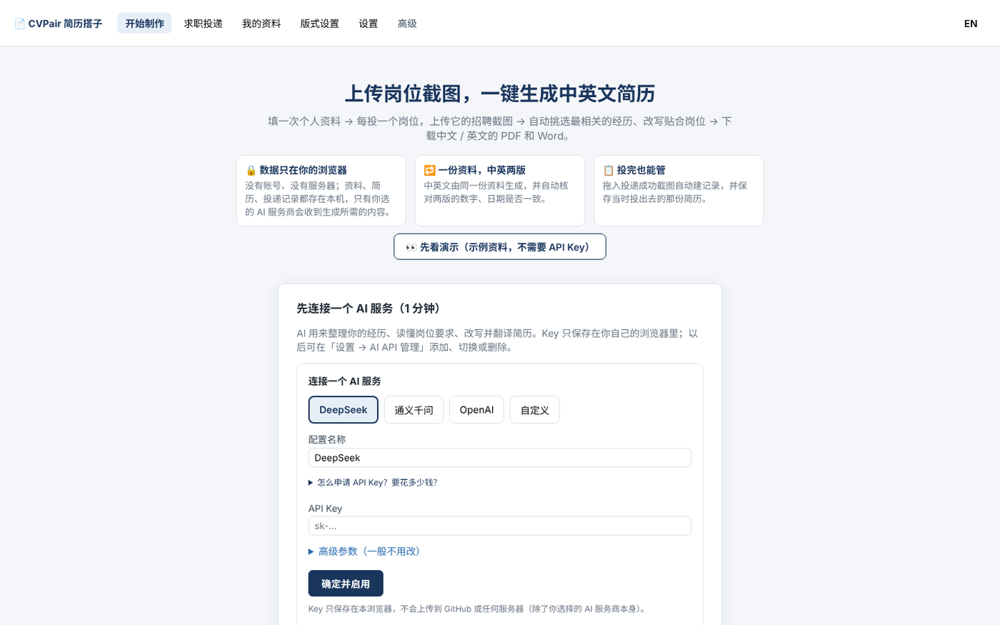
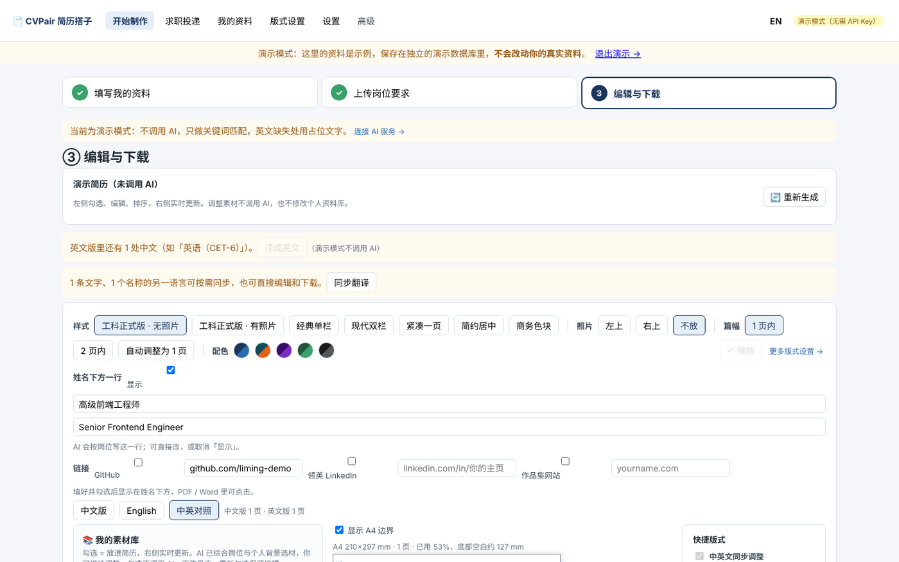
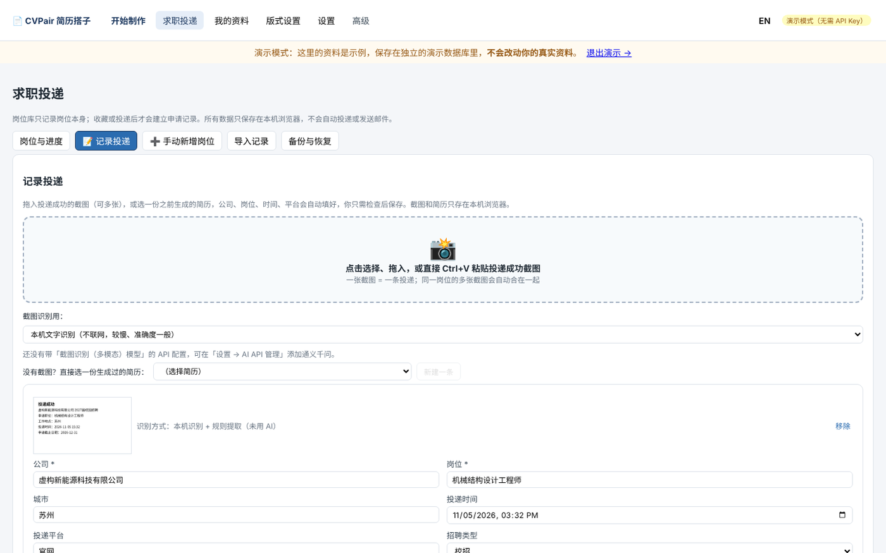

# CVPair

English | [中文](./README.zh-CN.md)

**A bilingual (Chinese / English) AI resume builder that runs entirely in your browser.** Fill in your profile once. For each job, upload a screenshot of the posting or paste the description, and AI picks the most relevant experience from *your* profile, tailors it to the role, and gives you a Chinese and an English resume at the same time (PDF + editable Word). After applying, log the application and keep the exact resume you sent.

**Use it online: <https://ranruiqian.github.io/cvpair/>** — no sign-up, no install. Want a quick look first? Open the [demo](https://ranruiqian.github.io/cvpair/?demo#wizard) (sample data, no API key needed).



## Why CVPair

- **Your data stays in your browser.** No account, no server, no database of ours. Your profile, resumes and applications live in your browser's IndexedDB. Only the AI provider *you* choose receives what's needed to generate; when generating a resume, your photo, contact details and date of birth are never sent.
- **One profile, two languages.** Both versions come from the same profile, with numbers and dates checked across languages; leftover Chinese in the English version is detected and translated.
- **No invented experience.** AI can only select and rewrite what's in your library, and every bullet traces back to a source entry, with a fact check after generation. Always read it through yourself before applying.
- **Layout measured on the real PDF.** Preview, PDF and Word share one layout engine. Page count is measured on the actual PDF, and “Auto-fit to 1 page” tightens spacing within readable minimums.
- **Track what you applied to.** Drop in the “application submitted” screenshot to create a record automatically, with the PDF you sent stored alongside — or replace it with your own edited PDF.
- **Bring your own AI key.** Works with DeepSeek, Qwen (Alibaba Cloud), OpenAI and any OpenAI-compatible API. You pay the provider directly for what you use; CVPair charges nothing.

## Features

| Area | What it does |
|---|---|
| Profile | Paste an old resume or upload PDF / Word / images; AI organises it into a structured library (education, work, projects, skills, certificates, awards, courses). Every field has Chinese and English versions; a glossary keeps translations consistent; snapshots are saved before every replace |
| Job parsing | Upload job screenshots (local OCR in the browser, or a vision model) or paste the JD; extracts responsibilities, must-haves, nice-to-haves and keywords. Match up to 3 jobs at the same company with one resume, or generate a general resume |
| Edit & download | Material pool (checking never calls AI), per-item CN/EN editing, layout presets (engineering formal, single / two column…), photo, colours, margins; auto-fit to 1 page and auto-trim; export Chinese and English PDF + Word as a zip (choose which files) |
| Extras | Cover letter, one-minute self-introduction and interview prep notes per job (optional) |
| Applications | Job library, status history, attachments, to-dos, interviews; log an application from a screenshot; import old CSV / JSON trackers; each application keeps an immutable resume snapshot and PDF |
| Backup | Export everything as one ZIP (with attachments) and import it on another device; optionally include API keys encrypted with a password |
| Interface | Chinese / English, switchable any time |

<details>
<summary>More screenshots</summary>





</details>

## Getting started

1. Open <https://ranruiqian.github.io/cvpair/> (use the **EN** button at the top right for the English interface).
2. Connect an AI service: pick a provider, paste your API key, click **Save and enable**. “How do I get an API key?” on the page walks you through each provider.
   - **DeepSeek** (cheap, reachable from mainland China): sign up at [platform.deepseek.com](https://platform.deepseek.com), top up a small amount, create an API key.
   - **Qwen**: create an API key in the Alibaba Cloud Model Studio (Bailian) console; its vision model (`qwen-vl-plus`) can also read application screenshots.
   - **OpenAI** or any **OpenAI-compatible** service: enter its base URL, model and key.
   - You pay the provider for what you use; generating a resume usually costs a few cents (check your provider's prices).
3. Paste your old resume or fill in your profile → add a job → generate, adjust, download.

> **Note:** data is stored in the current browser. Clearing browser data deletes it too — export a backup regularly under **Settings → Backup & restore**.

## Privacy & security

- There is no backend. The site is static files on GitHub Pages; everything runs in your browser.
- When AI is used, job details and the resume-relevant text from your profile are sent **directly** from your browser to the provider you configured. When generating a resume, your name, contact details, photo, date of birth and raw transcripts are not sent, and the page lists what is and isn't sent. When you use AI to import an old resume, the text you paste or upload is sent as-is.
- API keys are stored only in this browser; backups exclude keys by default.
- See [docs/SECURITY.md](docs/SECURITY.md) (Chinese) for details.

## Self-hosting

**Your own GitHub Pages:**

1. Fork this repository.
2. In your fork, go to **Settings → Pages → Build and deployment → Source** and choose **GitHub Actions**.
3. Push to `main` (or run *Deploy to GitHub Pages* from the Actions tab). Your site will be at `https://<your-username>.github.io/<repo-name>/`.

**Run locally:**

```bash
npm ci
npm run dev                        # http://localhost:5173 (add ?demo for demo mode)
npm run build && npm run preview   # production build, http://localhost:4173
```

Other static hosts (Vercel, Netlify, Cloudflare Pages): build command `npm run build`, output directory `dist`; set `BASE_PATH=/sub-path/` when serving from a sub-path.

## FAQ

**Does it apply to jobs for me?** No. CVPair never submits applications or sends email, and never guesses that something was applied to.

**Will the AI make things up?** It is designed to use only what's in your library, and generated text is checked for numbers, dates, degrees and other facts. Wording can still be off, so read everything before you apply.

**How do I move to another computer?** Export a full archive under **Settings → Backup & restore** and import it in the same place on the new computer.

**Which browsers?** Latest Chrome or Edge recommended. The first screenshot recognition downloads a ~20 MB OCR model, which is cached afterwards.

## Tech stack

React 19 · TypeScript · Vite · Dexie (IndexedDB) · @react-pdf/renderer (PDF with an embedded Noto Sans SC subset) · docx (Word) · tesseract.js (local OCR) · Vitest · Playwright

## Contributing

Issues and pull requests are welcome — please read [CONTRIBUTING.md](CONTRIBUTING.md) first. Developer docs live in [docs/](docs/README.md).

## License

[MIT](LICENSE)
