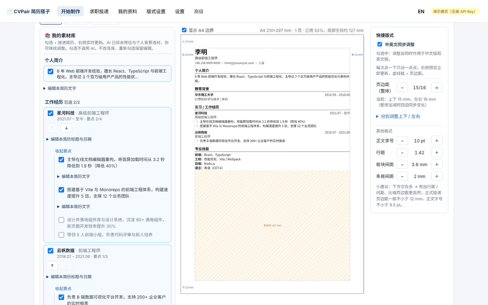
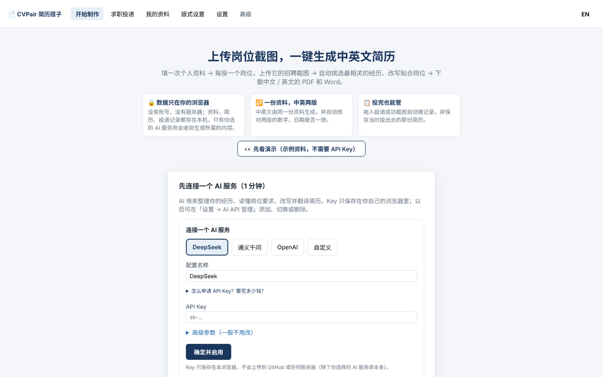
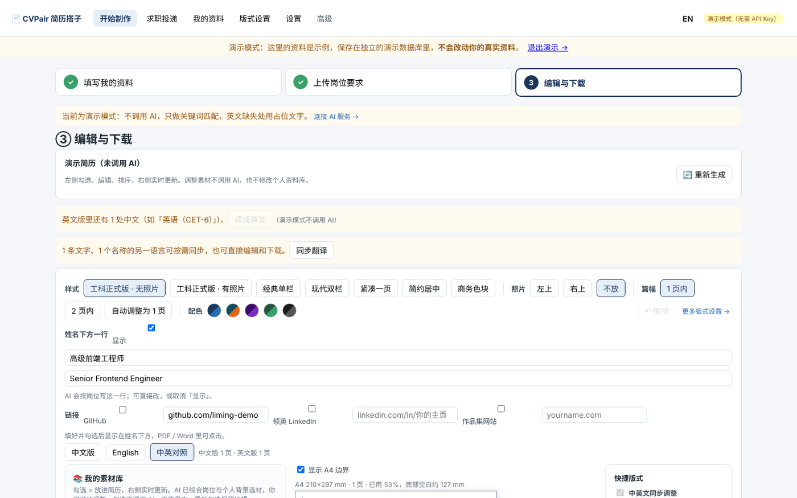
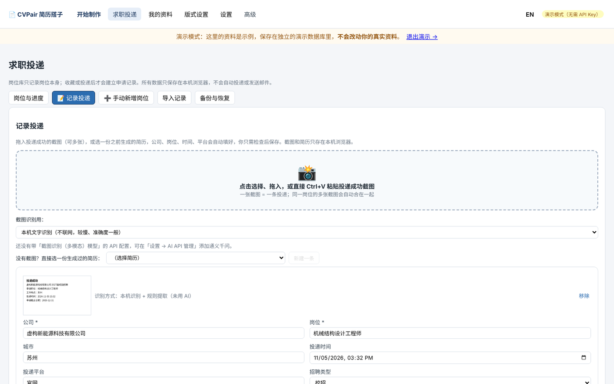
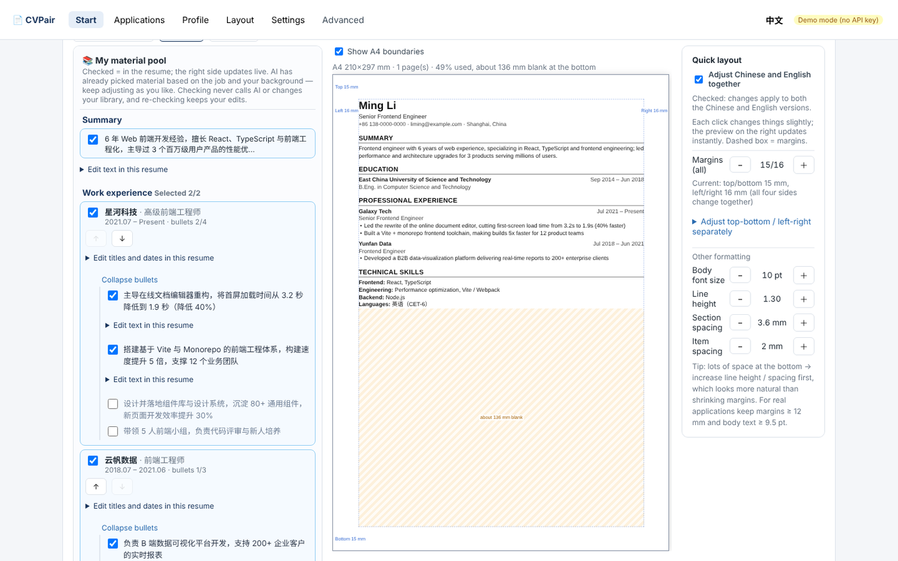

# CVPair 简历搭子

[English](./README.md) | 中文

**在浏览器里运行的中英双语 AI 简历工具。** 填一次个人资料，每投一个岗位，上传招聘截图或粘贴岗位描述，AI 从你的资料里挑出最相关的经历、改写贴合岗位，一次得到中文和英文两份简历（PDF + 可编辑的 Word）。投完还能记录投递、保存当时投出去的那份简历。

**在线使用：<https://ranruiqian.github.io/cvpair/>**（不用注册、不用安装；想先看效果可打开 [演示模式](https://ranruiqian.github.io/cvpair/?demo#wizard)，不需要 API Key）



## 为什么用它

- **数据只在你的浏览器里。** 没有账号、没有服务器、没有数据库。资料、简历、投递记录都保存在你自己浏览器的 IndexedDB 里；只有你自己选择的 AI 服务商会收到生成所需的内容；生成简历时，照片、联系方式、出生年月等个人信息不会发给 AI。
- **一份资料，中英两版。** 中英文简历来自同一份资料，并自动核对两版的数字、日期是否一致；英文版里残留的中文会被找出来补译。
- **不编造经历。** AI 只能从你的资料库里选材和改写，每条要点都能追溯到原始条目；生成后有事实核对。最终内容仍请你自己检查。
- **按真实页数排版。** 预览、PDF、Word 用同一套排版；页数按真实 PDF 测量，可一键「自动调整为 1 页」（有字号、行距下限，不会挤到难以阅读）。
- **投完也能管。** 拖入「投递成功」截图自动建投递记录，并存下那次投出去的简历 PDF；你自己微调过的 PDF 也可以替换上去。
- **自带 AI Key。** 支持 DeepSeek、通义千问、OpenAI 以及任何兼容 OpenAI 接口格式的服务，费用按用量直接付给服务商，本工具不收费、也不经手。

## 功能一览

| 模块 | 能做什么 |
|---|---|
| 我的资料 | 粘贴旧简历文字或上传 PDF / Word / 图片，AI 整理成结构化资料库（教育、工作、项目、技能、证书、奖项、课程）；每个字段都有中英两版；专有名词表保证译法统一；每次替换前自动存快照 |
| 岗位解析 | 上传招聘截图（浏览器本地识别文字，或用看图模型）或粘贴岗位描述，提取职责、必备要求、加分项和关键词；可同时匹配同一公司的 1–3 个岗位；没有具体岗位时可生成「公版简历」 |
| 编辑与下载 | 素材池勾选即时生效（不调用 AI）、逐条编辑中英文、多套版式（工科正式版、单栏、双栏…）、照片、配色、页边距；自动调整为 1 页、超页自动删减；导出中英文 PDF 与 Word（zip，可勾选要哪几个文件） |
| 求职材料 | 按岗位生成求职信、一分钟自我介绍和备考方向（可选） |
| 求职投递 | 岗位库、申请状态与历史、附件、待办、面试安排；从截图「记录投递」；导入以前的 CSV / JSON 投递表；每条投递保存不可修改的简历快照和 PDF |
| 备份与恢复 | 一键导出完整档案（ZIP，含附件），换电脑、换浏览器时导入即可；API Key 可选择用密码加密后一起备份 |
| 界面语言 | 中文 / English 随时切换 |

<details>
<summary>更多截图</summary>






</details>

## 快速开始

1. 打开 <https://ranruiqian.github.io/cvpair/>。
2. 连接一个 AI 服务：选服务商，粘贴 API Key，点「确定并启用」。页面上的「怎么申请 API Key？」有每家的申请步骤。
   - **DeepSeek**（推荐，国内直连、便宜）：在 [platform.deepseek.com](https://platform.deepseek.com) 注册、充值少量金额、创建 API Key。
   - **通义千问**：在阿里云百炼控制台创建 API Key；它的看图模型（qwen-vl-plus）还能识别投递截图。
   - 费用按用量从你自己的账户扣，生成一份简历通常只要几毛钱，具体以服务商价格为准。
3. 粘贴旧简历或手动填写资料 → 上传岗位截图 → 生成、调整、下载。

不想填 Key 也可以先用 [演示模式](https://ranruiqian.github.io/cvpair/?demo#wizard) 看完整流程（示例资料，存在独立的演示数据库，不影响你的真实资料）。

> **提醒：** 数据保存在当前浏览器。清除浏览器数据会一并删除资料，请定期在「设置 → 备份与恢复」导出备份。

## 隐私与安全

- 没有后端服务器。页面是 GitHub Pages 上的静态文件，所有计算都在你的浏览器里完成。
- 调用 AI 时，岗位要点和你资料里与简历相关的文字会**直接**从你的浏览器发送到你配置的服务商（不经过任何第三方）。生成简历时，姓名、联系方式、照片、出生年月、成绩单原文等不会发送，页面上会列出会发送和不会发送的内容；用「AI 帮我整理」导入旧简历时，会发送你粘贴或上传的那段文字本身。
- API Key 只保存在本浏览器；备份文件默认不含 Key。
- 详见 [docs/SECURITY.md](docs/SECURITY.md)。

## 自己部署

**部署到你自己的 GitHub Pages：**

1. Fork 本仓库。
2. 在你的仓库 **Settings → Pages → Build and deployment → Source** 选 **GitHub Actions**。
3. 推送到 `main`（或在 Actions 里手动运行 *Deploy to GitHub Pages*）。网址为 `https://<你的用户名>.github.io/<仓库名>/`。

**本地运行：**

```bash
npm ci
npm run dev        # http://localhost:5173（加 ?demo 打开演示模式）
npm run build && npm run preview   # 生产构建，http://localhost:4173
```

其他静态托管（Vercel、Netlify、Cloudflare Pages）：构建命令 `npm run build`，输出目录 `dist`；部署在子路径时设置环境变量 `BASE_PATH=/子路径/`。

## 常见问题

**会自动帮我投递吗？** 不会。本工具不投递、不发邮件，也不会把未知状态猜成「已投递」。

**AI 会编造经历吗？** 设计上 AI 只能使用你资料库里的内容，生成后还有数字、日期、学位等事实核对；但 AI 仍可能措辞不准，投递前请自己通读。

**换电脑怎么办？** 在「设置 → 备份与恢复」导出完整档案，到新电脑的同一位置导入。

**支持哪些浏览器？** 推荐最新版 Chrome、Edge。首次识别截图会下载约 20 MB 的识别模型，之后会缓存。

## 技术栈

React 19 · TypeScript · Vite · Dexie（IndexedDB）· @react-pdf/renderer（PDF，内嵌思源黑体子集）· docx（Word）· tesseract.js（本地 OCR）· Vitest · Playwright

## 参与贡献

欢迎提 Issue 和 Pull Request，请先看 [CONTRIBUTING.md](CONTRIBUTING.md)。开发者文档在 [docs/](docs/README.md)。

## 许可证

[MIT](LICENSE)
